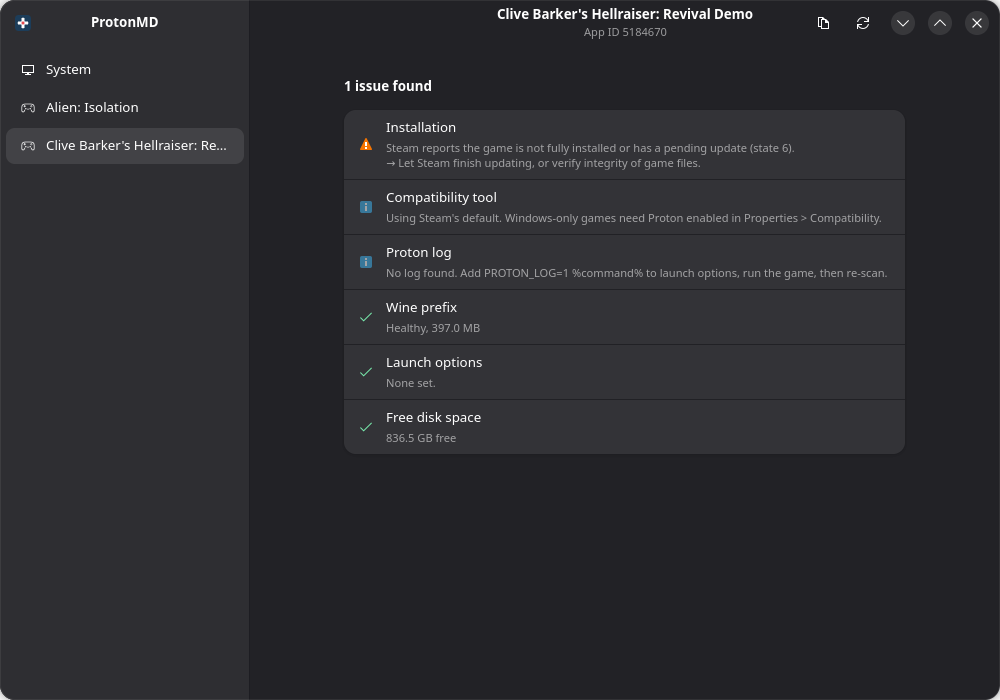

# ProtonMD

Diagnose why a Linux game won't run.

ProtonMD checks your GPU driver, Vulkan setup and kernel limits, then inspects each Steam game's
Wine prefix, Proton version, launch options and shader cache. It explains what is wrong and offers
safe fixes, each one shown and confirmed before it runs.

> Unofficial. Not affiliated with Valve or Proton AG.

## What it checks

- GPU driver, 64-bit and 32-bit Vulkan
- `vm.max_map_count` and the open-file limit (esync)
- Missing or wrong Proton / compatibility tool
- Broken or incomplete Wine prefixes
- Risky launch options (`DXVK_ASYNC`, `PROTON_USE_WINED3D`, a missing `%command%`, ...)
- Shader cache size, free disk space, known errors in Proton logs
- Steam libraries on external drives, including ones Steam doesn't list

## Install

Flatpak (from source):

    flatpak-builder --user --install --force-clean build-dir io.github.metalmike17.ProtonMD.yml

Arch / CachyOS: see `packaging/aur/PKGBUILD`.

From source: `python -m protonmd` (needs GTK4, libadwaita and PyGObject). Use `--cli` for plain text output.

## Flatpak limitations

The sandbox can't run host commands, so the Vulkan 64-bit check, Proton log scanning and
running-game detection are unavailable. The native package has no such limits.

## Contributing

Checks are plain Python in `protonmd/checks/`, and the known-bad launch options and log signatures are
data in `protonmd/checks/rules.py`. New rules are the easiest way to help. Open an issue with the
"New check" template or send a pull request with a test.

## Tests

    python -m unittest discover -s tests

## License

GPL-3.0-or-later.
